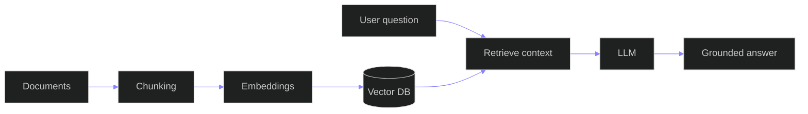
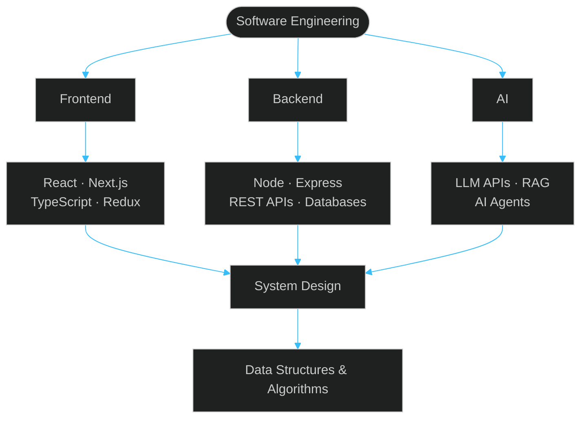

  
  
  
  
  

##  About

Full Stack Developer focused on building production-ready web applications with modern JavaScript, scalable APIs and clean architecture. I like turning complex requirements into reliable, maintainable software, and I'm now extending that foundation into AI-powered products using LLMs and RAG.

<table>
  <tr>
    <td width="50%" valign="top">

**🔭 Currently**

- Advanced Full-Stack Development
- Data Structures & Algorithms
- System Design
- Generative AI & RAG

</td>
    <td width="50%" valign="top">

**⚙️ At a glance**

| | |
| --- | --- |
| **Role** | Full Stack Developer |
| **Frontend** | React · Next.js · TypeScript |
| **Backend** | Node.js · Express · REST APIs |
| **Data** | MongoDB · MySQL · PostgreSQL |
| **Real-time** | Socket.IO |
| **Cloud** | AWS · Vercel · Render |

</td>
  </tr>
</table>

## ⚡ Tech Stack

<table>
  <tr>
    <td width="190"><b>🎨 Frontend</b></td>
    <td></td>
  </tr>
  <tr>
    <td><b>🛠 Backend &amp; Database</b></td>
    <td></td>
  </tr>
  <tr>
    <td><b>☁️ Tools &amp; Cloud</b></td>
    <td></td>
  </tr>
  <tr>
    <td><b> AI Engineering</b></td>
    <td>LLM APIs · RAG · AI Assistants · Prompt Engineering · AI-powered Web Apps</td>
  </tr>
</table>

##  Featured Projects

<table>
  <tr>
    <td width="50%" valign="top">

###  EduManage
**Education Management Platform**

A full-stack platform that brings educational operations into one centralized dashboard.

- Students, teachers, classes & subjects
- Attendance, exams, fees & timetable
- Authentication, authorization & notifications
- Built-in AI assistant
- REST API architecture

`Next.js` `React` `Node.js` `Express.js` `MongoDB`

</td>
    <td width="50%" valign="top">

###  UphaarBox
**Modern Gifting Platform**

A full-stack e-commerce application focused on smooth product discovery and a simple purchasing experience.

- Product browsing & discovery
- Purchase flow
- REST API backend

`React` `Node.js` `Express.js` `MongoDB` `REST APIs`

</td>
  </tr>
</table>

  

##  AI Engineering

My goal is to combine **Full-Stack Engineering + AI** to build practical, production-ready applications. I'm currently building and exploring document Q&A, assistants and agents on top of a RAG pipeline:

##  Engineering Focus

## Currently Learning

**Data Structures & Algorithms**

`Arrays` → `Strings` → `Hashing` → `Two Pointers` → `Sliding Window` → `Stack` → `Queue` → `Linked List` → `Trees` → `Graphs` → `Dynamic Programming`

<table>
  <tr>
    <td width="50%" valign="top">

**Advanced Development**

- TypeScript
- System Design
- Backend Architecture
- Performance Optimization
- Testing
- CI/CD
- AWS

</td>
    <td width="50%" valign="top">

**AI Engineering**

- LLM APIs
- Embeddings
- Vector Databases
- RAG
- AI Agents
- AI Application Architecture

</td>
  </tr>
</table>

## GitHub Activity

<table>
  <tr>
    <td align="center">
      
    </td>
    <td align="center">
      
    </td>
  </tr>
</table>

<picture>
  <source media="(prefers-color-scheme: dark)" srcset="https://raw.githubusercontent.com/rajeshsarkar95/rajeshsarkar95/output/github-contribution-grid-snake-dark.svg" />
  <source media="(prefers-color-scheme: light)" srcset="https://raw.githubusercontent.com/rajeshsarkar95/rajeshsarkar95/output/github-contribution-grid-snake.svg" />
  
</picture>

##  2026–2027 Engineering Goals

- [x] Build production-grade Full Stack applications
- [ ] Master JavaScript & TypeScript
- [ ] Strengthen DSA fundamentals
- [ ] Improve backend architecture
- [ ] Learn System Design
- [ ] Build RAG applications
- [ ] Build AI Agents
- [ ] Contribute to Open Source
- [ ] Grow into a stronger Software Engineer

##  Open To

`Full Stack Developer` `MERN Stack Developer` `React Developer` `Next.js Developer` `Software Engineer` `SDE-1` `AI / Full Stack Engineer`

## 🤝 Let's Connect

  <a href="https://github.com/rajeshsarkar95">GitHub</a> ·
  <a href="https://www.linkedin.com/in/rajesh-sarkar-9777b0302/">LinkedIn</a> ·
  <a href="https://prorajeshsarkar.vercel.app/">Portfolio</a>

